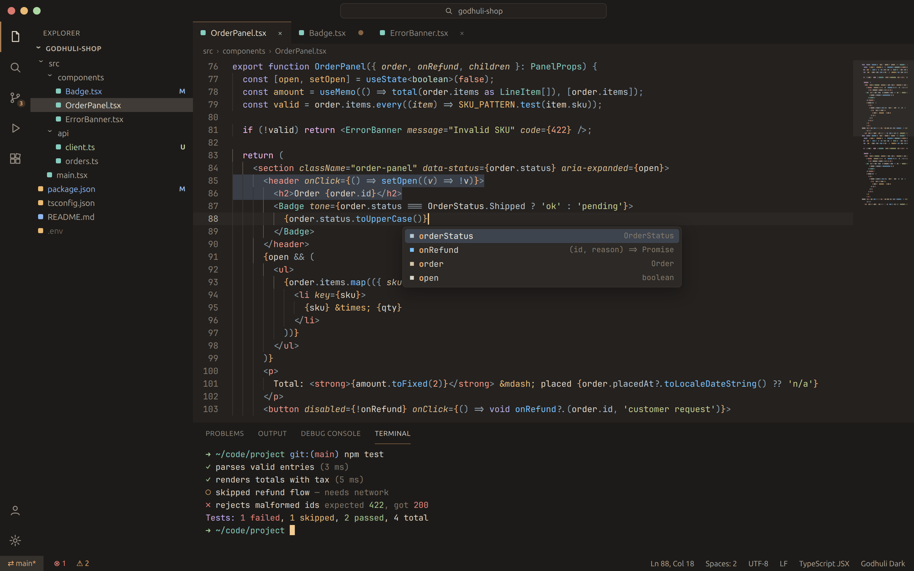
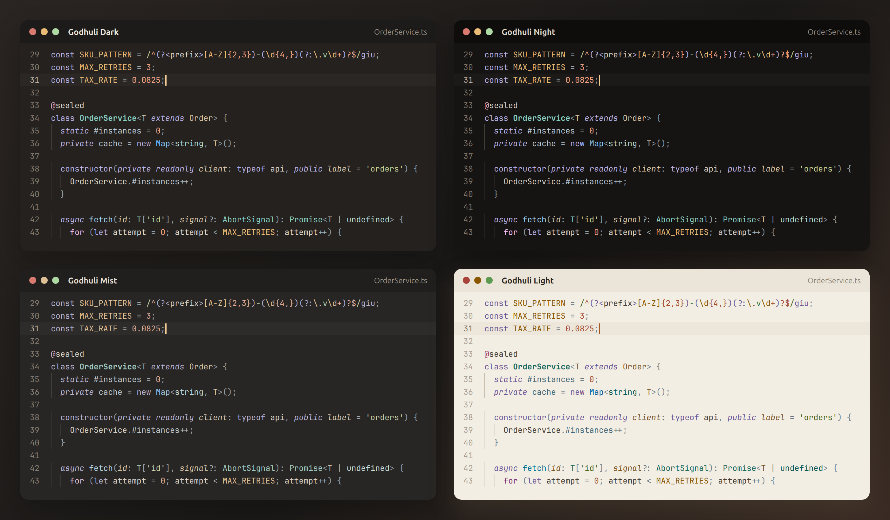
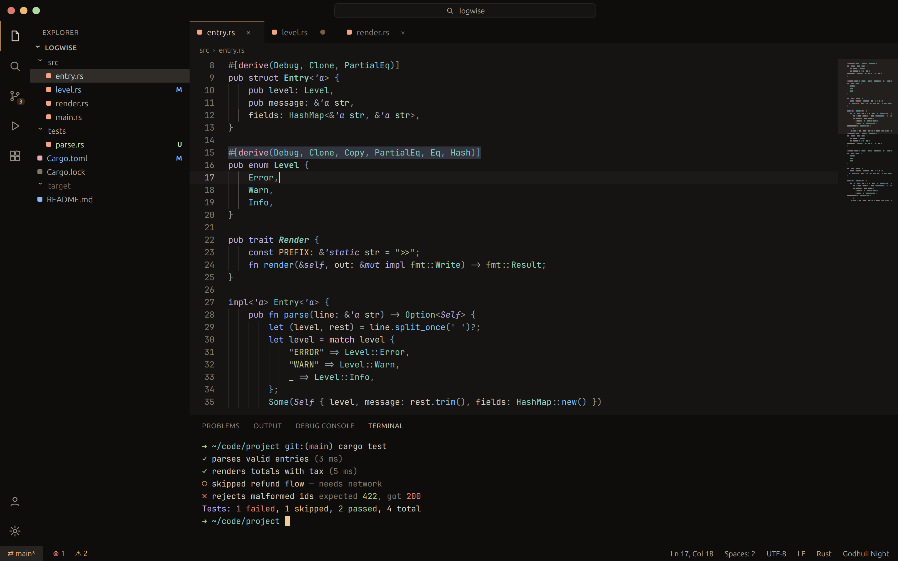
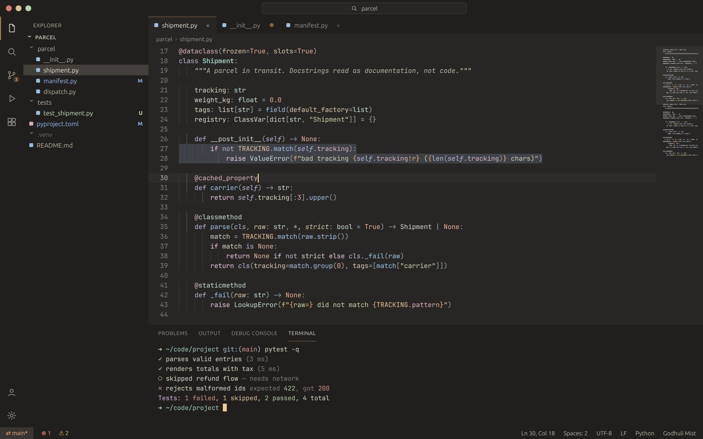
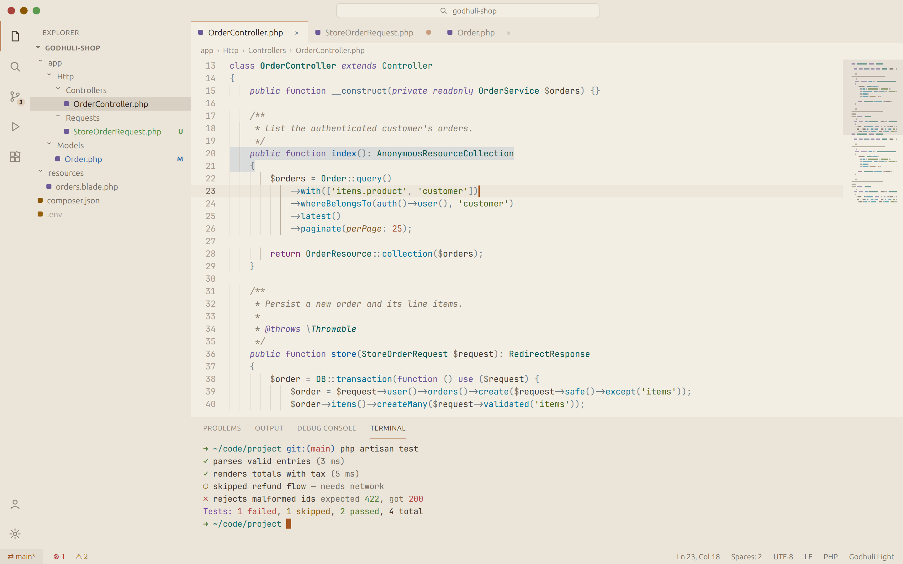
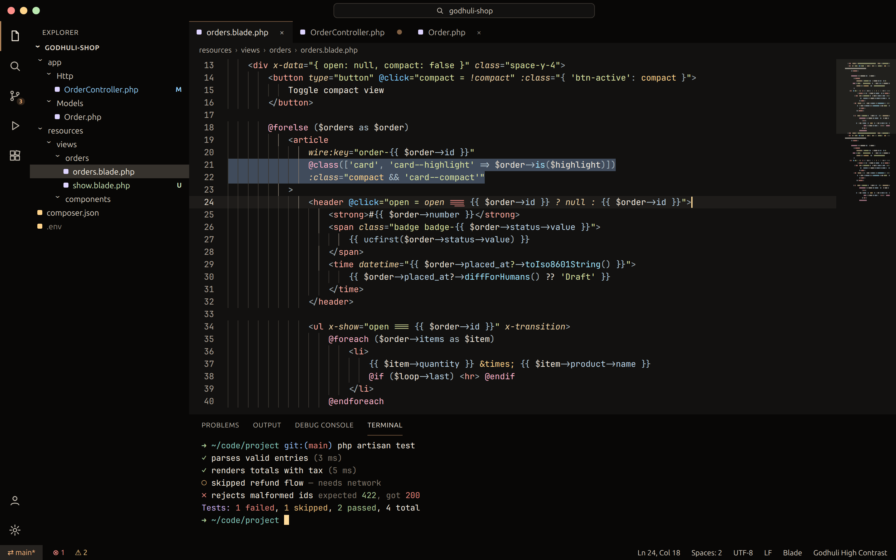

# Godhuli Theme: Warm Dark & Light Theme for VS Code, Designed for Long Coding Sessions

[](https://marketplace.visualstudio.com/items?itemName=NotifyX.godhuli-theme)
[](https://marketplace.visualstudio.com/items?itemName=NotifyX.godhuli-theme)
[](https://marketplace.visualstudio.com/items?itemName=NotifyX.godhuli-theme&ssr=false#review-details)
[](https://open-vsx.org/extension/NotifyX/godhuli-theme)
[](LICENSE)

**A warm, calm VS Code theme for long days of code.** Godhuli comes in five flavors: a warm **dark theme**, a deep **OLED night theme**, a soft low-contrast **Mist**, a paper-like **light theme**, and an accessible **High Contrast** theme. Every color has one job. Types, calls, values, control flow and comments each have their own role, so you can read the structure of code at a glance without a rainbow on screen.



> **Godhuli** is the Bengali word for dusk, the "cow-dust hour" when daylight turns warm and the sky still holds its blue. The theme uses that light: a warm umber canvas, cool twilight blues and teals for structure, soft natural greens for text values, and warm ember tones for constants and numbers.

## Why Godhuli?

- **Designed for visual comfort.** The background is warm umber-gray, never pure black or harsh white. Large surfaces carry almost no color, and the UI stays quiet so the editor is the focus.
- **Color with intent, not a rainbow.** Six hue families, each with a clear meaning. Related things share a family; different things don't.
- **Structure you can scan.** Control flow (`if`, `return`, `await`, `throw`) is brighter than other keywords. Declarations are bold, interfaces and traits are italic, and punctuation steps back.
- **Tested for color-vision deficiency.** Key pairs such as added vs. deleted, errors vs. successes, types vs. strings and functions vs. keywords are checked under protanopia, deuteranopia and tritanopia simulations. Critical states differ in brightness, and use squiggles and icons, not hue alone.
- **Measured, not guessed.** Every color is contrast-checked with APCA, a candidate contrast method for WCAG 3. That includes when selections, search matches, diff highlights and widgets sit underneath.
- **A borderless, modern workbench.** The sidebar, tabs, panel and status bar share one calm surface, one step below the editor.
- **No rainbow lines.** A release gate measures how many color families compete on each line of 129 real samples. 95% of lines use three or fewer.

## Flavors



| Flavor | Best for | Background |
|---|---|---|
| **Godhuli Dark** | The everyday warm dark theme for regular monitors | `#24211F` warm umber |
| **Godhuli Night** | OLED screens and dark rooms. A deeper canvas with softened text to limit glow | `#161413` near-black |
| **Godhuli Mist** | Very long sessions. The lowest color and softest contrast that stays readable | `#282624` muted gray |
| **Godhuli Light** | Daylight and bright offices. Warm, low-glare paper that isn't yellow | `#F3EEE4` warm paper |
| **Godhuli High Contrast** | Low vision, glare, projectors and screen sharing. Every token at APCA Lc 65+, with visible borders and focus rings | `#121110` deep umber |

All five share the same semantic role system, so switching flavors never changes what a color means.

### Godhuli Night: OLED dark theme



### Godhuli Mist: low contrast, soft theme



### Godhuli Light: warm paper light theme



### Godhuli High Contrast: accessible, still warm



## Install

**In VS Code:**
1. Open the **Extensions** view (`Ctrl+Shift+X` / `Cmd+Shift+X`).
2. Search for **Godhuli** and click **Install**.
3. Open the Command Palette (`Ctrl+Shift+P` / `Cmd+Shift+P`), run **Preferences: Color Theme**, and pick a **Godhuli** flavor.

**Quick Open:** press `Ctrl+P` / `Cmd+P` and paste:

```
ext install NotifyX.godhuli-theme
```

**Cursor, VSCodium, Windsurf, Gitpod:** install **Godhuli** from [Open VSX](https://open-vsx.org/extension/NotifyX/godhuli-theme). It's the same theme.

## Design philosophy

Godhuli gives every syntax category a role, and every role a hue family:

| Family | Roles | What it tells you |
|---|---|---|
| **Violet** | keywords, modifiers · *control flow in brighter orchid* | language machinery; brighter where execution branches or exits |
| **Blue** | functions · methods (lighter, cyan-leaning) · built-ins (muted) | something is *called* |
| **Teal** | classes, structs, enums · *interfaces/traits italic* · built-in types · namespaces (gray-teal) | something is a *type* |
| **Green** | strings · regular expressions (jade) | literal text |
| **Ember** | constants & enum members (amber) · numbers & booleans (coral) · decorators & macros (rose) · tags (coral-red) | fixed values and compile-time magic |
| **Neutral** | variables (ink) · parameters & generic `T` (sand) · properties (slate) · comments (warm gray, italic) · operators & punctuation (cool slate, quiet) | the things you read most get the calmest colors |

Font styles are used sparingly and always mean the same thing:
- *Italic* is for comments and docs, modifiers (`static`, `readonly`, `async`), `this`/`self`, parameter declarations, markup attributes, and interfaces/traits.
- **Bold** is reserved for type declarations, Markdown headings, and `TODO`/`FIXME` tags.

### Inspiration, not imitation

Godhuli learned from the themes developers love most. It took One Dark Pro's recognizable syntax hierarchy, Dracula's strong token separation, Tokyo Night's atmospheric UI, Catppuccin's consistent color roles, Everforest's warmth, Ayu's borderless workbench and the GitHub theme's practical readability. Palettes, branding and token maps are its own, and Godhuli is not affiliated with any of these projects.

## Features

- **Full semantic highlighting.** Language servers can tell classes from interfaces, functions from methods, parameters from variables, declarations from references and built-ins from user code. Generic type parameters and static members are marked too, and deprecated symbols are struck through while keeping their own color.
- **Tested on 85 languages and template formats.** Every one has a realistic sample in [`preview/`](preview/), tokenized with VS Code's own TextMate grammars and checked rule by rule. See the full list in [docs/LANGUAGES.md](docs/LANGUAGES.md). Highlights:
  - **Web:** JavaScript, TypeScript, React (JSX/TSX), Next.js, Vue, Nuxt, Angular, Svelte, Astro, Remix, NestJS, HTML, CSS, SCSS/Sass, Less, Tailwind, GraphQL, JSON/JSONC/JSON5
  - **PHP:** PHP 8, Laravel (controllers, Eloquent, migrations, Blade with Alpine), Symfony + Twig, WordPress
  - **Backend:** Python (Django, FastAPI, Flask), Java (Spring Boot), Kotlin, Scala, C# (ASP.NET), F#, Go, Rust, C, C++, Ruby (Rails, ERB), Elixir, Swift, Dart (Flutter), Haskell, Lua, SQL, Prisma
  - **Tooling:** Bash/Zsh/Fish/PowerShell, Dockerfile, Docker Compose, Kubernetes, Terraform, GitHub Actions, YAML, TOML, INI, `.env`, nginx, Makefile, CMake, Markdown/MDX, git commits, rebase todos and diffs
- **Templates done right.** Blade, Jinja, Django and Twig delimiters share one color, so you can see where the template language starts and the HTML ends.
- **Readable diffs and merges.** Syntax colors stay legible inside added, removed and conflicting lines.
- **Matching terminal colors.** All 16 ANSI colors are tuned for each flavor.
- **Calm bracket pair colors.** Six soft colors that stay apart from each other, with unmatched brackets flagged as errors.
- **Every part of the UI is themed:** suggestions, hover, peek, inlay hints, ghost text (AI completions), sticky scroll, notebooks, testing, debugging, the merge editor, Source Control graph and chat.

## Recommended editor settings (optional)

Godhuli never changes your font or editor settings. If you'd like the look in the screenshots, add this to your `settings.json`:

```jsonc
{
  "editor.fontFamily": "'JetBrains Mono', 'Fira Code', 'Cascadia Code', monospace",
  "editor.fontLigatures": true,
  "editor.fontSize": 14,
  "editor.lineHeight": 1.6,
  "editor.semanticHighlighting.enabled": true,
  "editor.bracketPairColorization.enabled": true,
  "editor.guides.bracketPairs": "active"
}
```

Install the font you want first ([JetBrains Mono](https://www.jetbrains.com/lp/mono/), [Fira Code](https://github.com/tonsky/FiraCode) or [Cascadia Code](https://github.com/microsoft/cascadia-code)); VS Code falls back to the next font in the list. If you don't like ligatures (`=>` drawn as ⇒), set `"editor.fontLigatures": false`.

**Extra comfort settings**, if you want a calmer editor:

```jsonc
{
  "editor.cursorBlinking": "phase",              // fades instead of flashing
  "editor.cursorSmoothCaretAnimation": "on",     // the caret glides, so your eye can follow it
  "editor.renderLineHighlight": "all",           // current line marked in the gutter and the text
  "editor.letterSpacing": 0.3,                   // a little air between glyphs at small sizes
  "terminal.integrated.fontFamily": "'JetBrains Mono', monospace",
  "terminal.integrated.lineHeight": 1.2
}
```

**Which flavor when?**
- **Dark** for everyday work.
- **Mist** late at night or after a long day.
- **Night** on OLED screens in a dark room.
- **Light** in daylight.
- **High Contrast** when sharing your screen, presenting, or whenever text feels hard to read.

## Accessibility & contrast

Each syntax role has its own contrast target, rather than one number for everything. Comments should recede, identifiers should read effortlessly, and punctuation should stay out of the way.

| Role (APCA Lc vs editor background) | Dark | Night | Mist | Light | High Contrast | Target (HC target) |
|---|---:|---:|---:|---:|---:|---|
| Identifiers | 79.9 | 76.1 | 74.8 | 85.2 | 96.1 | 75–92, Mist 69+, Night ≤ 78 (90+) |
| Strings | 71.1 | 72.7 | 70.3 | 72.4 | 87.1 | ≥ 70 (80+) |
| Control flow | 73.4 | 75.0 | 72.6 | 78.5 | 95.0 | ≥ keywords + 5 (85+) |
| Types | 66.3 | 67.9 | 65.3 | 72.1 | 87.3 | ≥ 60 (80+) |
| Functions | 63.6 | 65.2 | 62.6 | 74.0 | 71.2 | ≥ 60 (70+) |
| Keywords | 59.9 | 61.5 | 59.0 | 69.9 | 83.4 | ≥ 58 (75+) |
| Comments | 48.5 | 48.0 | 47.8 | 51.1 | 61.2 | 45–60 and ≥ 5 below every code color (60–76) |
| Punctuation | 44.7 | 46.3 | 45.9 | 55.3 | 57.9 | quiet, ≥ 15 below identifiers (55–75) |

- **Checked where it matters.** Text contrast is also verified on top of selections, inactive selections, find matches, word highlights, diff lines, merge conflicts, sticky scroll, peek views, suggestion and hover widgets, inlay hints and tabs.
- **Neighbors stay apart.** Tokens that sit side by side are checked to stay distinguishable under every color-vision simulation. Examples: punctuation vs. comments, functions vs. methods, decorators vs. regexes, types vs. built-in types, and variables vs. parameters and properties.
- **Distinct assistance text.** Ghost text (AI suggestions) is cool gray and upright, comments are warm and italic, and inlay hints are teal-gray chips, so you never mistake one for another.
- **Low color on large areas.** Backgrounds stay nearly neutral (C\* ≤ 6, paper ≤ 8). Only errors, debugging and the ember accent use strong color.
- **Clear priority.** The colors follow the order your eye should find things in. Errors are the most saturated diagnostic, and control flow sits above other keywords. Operators read above punctuation, while comments and punctuation recede below every code color.
- **Always find the cursor.** The caret keeps strong contrast on the current line and over selections. Secondary cursors are distinguishable from the primary one, and error, warning, info and hint squiggles each stay readable. Errors and warnings stay distinct under every color-vision simulation, because their squiggles have the same shape.
- **Verified with real language servers.** Semantic colors are checked against the tokens that TypeScript, Intelephense (PHP), Pylance (Python), rust-analyzer and Volar (Vue) actually emit.

No theme can promise to prevent eye strain. Godhuli is designed for comfortable, long sessions, and its contrast is measured rather than guessed. Full per-role values (hex, L\*, C\*, hue, contrast) for every flavor are in [docs/PALETTE.md](docs/PALETTE.md).

## FAQ

**Is there an OLED or pure-black version?**
**Godhuli Night** is the OLED flavor. The background is near-black (not `#000`), and identifier contrast is capped to limit the glow (halation) bright text causes on OLED screens.

**Why don't I see different colors for classes, parameters or properties?**
Turn on `"editor.semanticHighlighting.enabled": true`, and make sure your language extension (for example TypeScript, Pylance, Intelephense or rust-analyzer) is active.

**Can I tweak a color?**
Yes. Use `workbench.colorCustomizations` and `editor.tokenColorCustomizations` scoped to `"[Godhuli Dark]"` in your settings. To change the palette itself, see *Development* below.

## Love it? Leave a rating ⭐

Ratings and reviews help other developers find Godhuli. If the theme makes your evenings easier, please [rate it on the Marketplace](https://marketplace.visualstudio.com/items?itemName=NotifyX.godhuli-theme&ssr=false#review-details). Found a token that looks wrong? [Open an issue](https://github.com/awalhadi/godhuli-theme/issues) with a screenshot and the language.


## License

[MIT](LICENSE)
