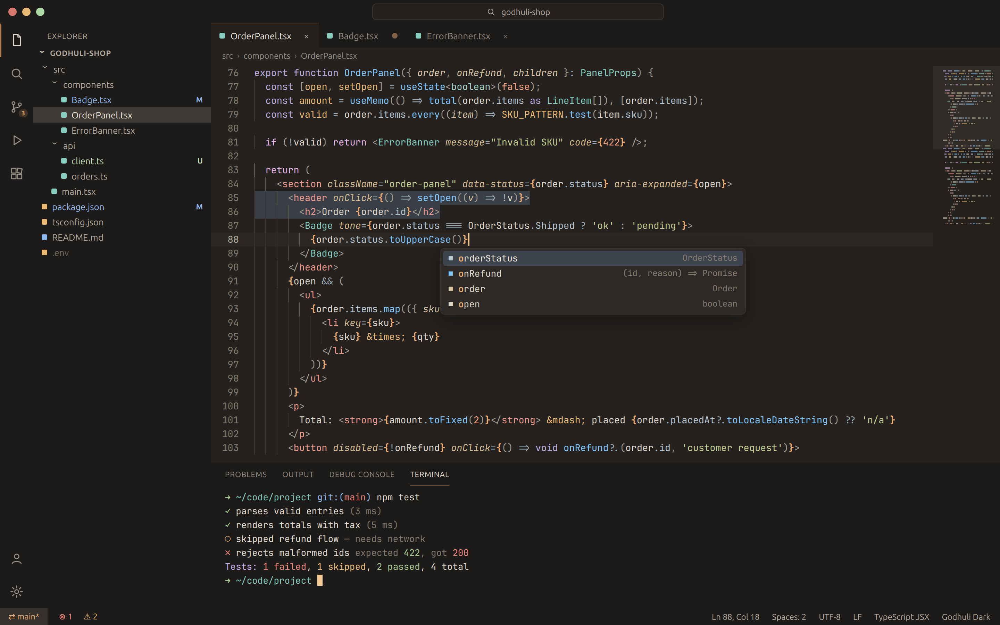
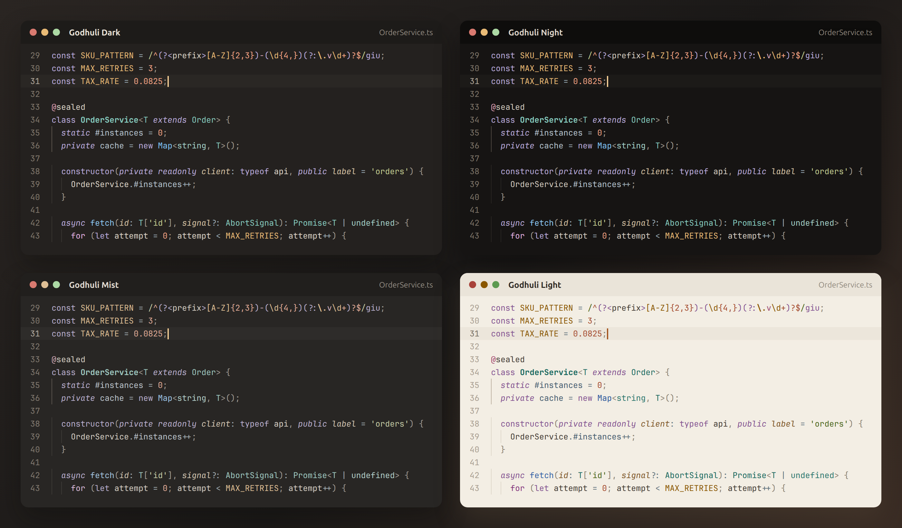
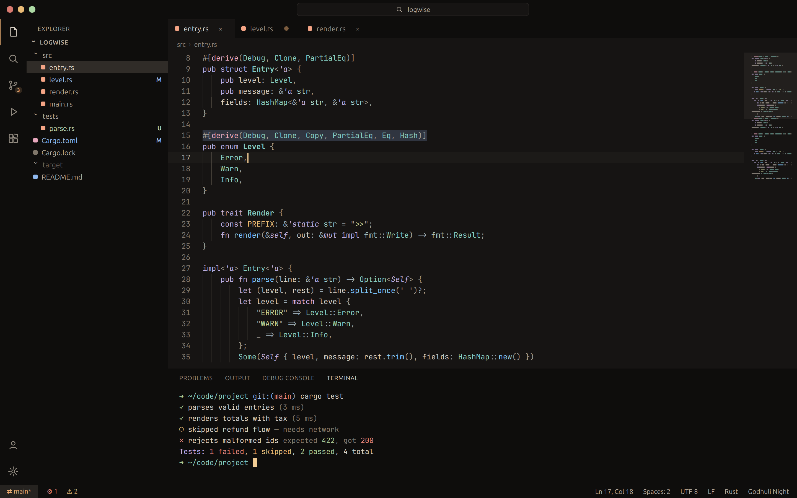
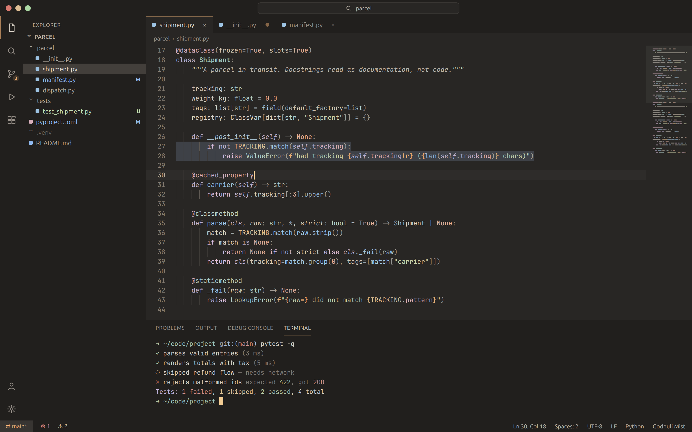
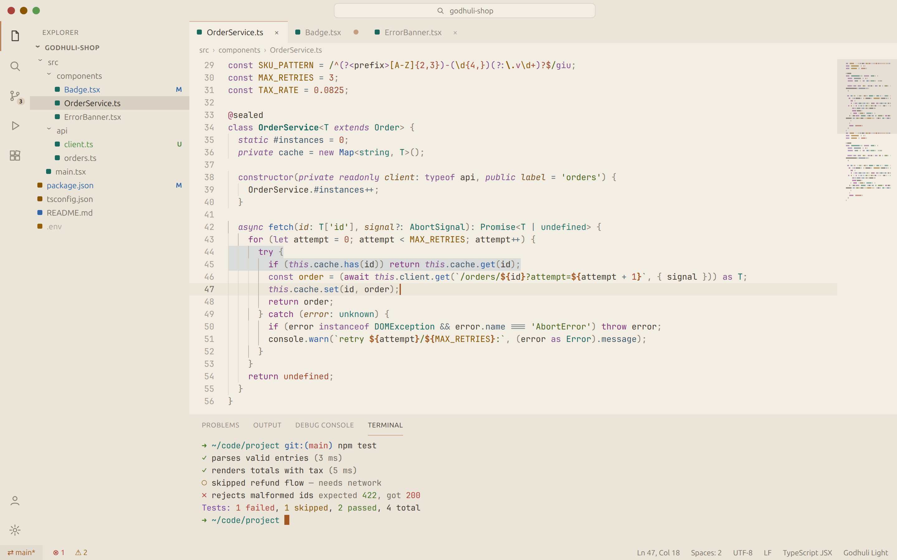

# Godhuli Theme: Warm, Eye-Comfort Dark & Light Theme for VS Code

[](https://marketplace.visualstudio.com/items?itemName=your-publisher-id.godhuli-theme)
[](https://marketplace.visualstudio.com/items?itemName=your-publisher-id.godhuli-theme)
[](https://marketplace.visualstudio.com/items?itemName=your-publisher-id.godhuli-theme&ssr=false#review-details)
[](https://open-vsx.org/extension/your-publisher-id/godhuli-theme)
[](LICENSE)

**A warm, low-blue-light VS Code theme for long coding sessions.** Godhuli comes in four flavors: a warm **dark theme**, a deep **OLED night theme**, a soft low-contrast **Mist**, and a paper-like **light theme**. All four are colorblind-safe, borderless and tuned with measured contrast, so your eyes stay relaxed while types, strings and control flow stay easy to see.



> **Godhuli** is the Bengali word for dusk, the "cow-dust hour" when daylight turns warm and the sky still holds its blue. The theme uses that light: a warm umber canvas, cool twilight blues for structure, and warm ember tones for strings and values.

## Why Godhuli?

- **Easier on your eyes after hours of coding.** The background is warm umber-gray, never pure black or harsh white. It has very little blue light, and the UI stays quiet, so you won't want to turn the brightness down at 1 am.
- **Code you can read at a glance.** Types, functions, strings, keywords and comments each have their own clear role. Control flow (`if`, `return`, `await`) stands out, and punctuation steps back.
- **Colorblind friendly.** Checked against protanopia, deuteranopia and tritanopia simulations. Added and removed lines, and passed and failed tests, differ in brightness, not only red vs. green.
- **A modern, borderless workbench.** The sidebar, tabs, panel and status bar share one calm surface, and the editor is the brightest part of the screen. There are no distracting divider lines.
- **Built on measurements, not guesswork.** Every color is contrast-checked with APCA, a candidate contrast method for WCAG 3, including when selections, search matches and diff highlights sit underneath.

## Four flavors



| Flavor | Best for | Background |
|---|---|---|
| **Godhuli Dark** | The everyday warm dark theme for regular monitors | `#24211F` warm umber |
| **Godhuli Night** | OLED screens and dark rooms. A deeper canvas with softened text to avoid glow | `#161413` near-black |
| **Godhuli Mist** | Tired eyes and very long sessions. The lowest color and softest contrast | `#282624` muted gray |
| **Godhuli Light** | Daylight and bright offices. A warm, low-glare paper look | `#F3EEE4` warm paper |

### Godhuli Night: OLED dark theme



### Godhuli Mist: low contrast, soft theme



### Godhuli Light: warm paper light theme



## Install

**In VS Code:**
1. Open the **Extensions** view (`Ctrl+Shift+X` / `Cmd+Shift+X`).
2. Search for **Godhuli** and click **Install**.
3. Open the Command Palette (`Ctrl+Shift+P` / `Cmd+Shift+P`), run **Preferences: Color Theme**, and pick a **Godhuli** flavor.

**Quick Open:** press `Ctrl+P` / `Cmd+P` and paste:

```
ext install your-publisher-id.godhuli-theme
```

**Cursor, VSCodium, Windsurf, Gitpod:** install **Godhuli** from [Open VSX](https://open-vsx.org/extension/your-publisher-id/godhuli-theme). It's the same theme.

## Coming from another theme?

Godhuli is a good fit if you like…

| If you like | What feels familiar | What's different in Godhuli |
|---|---|---|
| **Gruvbox** | Warm, earthy colors for long sessions | Cleaner, less muddy tones, a cool blue/teal structure, and a borderless modern UI |
| **Nord** | Calm, low-noise colors | A warm canvas instead of cool blue, and types stay clearly visible |
| **Tokyo Night** | Atmospheric depth and calm blues | A warm background with less blue light. Keywords are tuned to stay distinct for colorblind users |
| **Everforest / Rosé Pine** | Soft, comfortable, natural palette | Higher measured legibility for types and strings, plus OLED and low-contrast flavors |
| **Solarized / Zenburn** | Low-contrast eye comfort | Modern semantic highlighting and a fully themed workbench, terminal and diff |

## Features

- **Full semantic highlighting.** Language servers can tell classes, interfaces, enums, parameters, properties, built-ins, deprecated code and more apart.
- **Language support** tuned token by token:
  - JavaScript, TypeScript, React (JSX/TSX), Vue
  - Python, Rust, Go, C/C++, C#, Java, PHP/Laravel Blade, SQL
  - Shell, HTML, CSS/SCSS/Less, JSON, YAML, TOML, Markdown, Dockerfile, git and log files
- **JSX done right.** Components look like types, HTML tags look like tags, and attributes are gold.
- **Readable diffs and merges.** Syntax colors stay visible inside added and removed lines.
- **Matching terminal colors.** All 16 ANSI colors are tuned for each flavor.
- **Calm bracket pair colors:** six soft colors, with unmatched brackets flagged as errors.
- **Every part of the UI is themed:** suggestions, hover, peek, inlay hints, ghost text (AI completions), sticky scroll, notebooks, testing and debugging.

## Recommended settings

```jsonc
{
  "workbench.colorTheme": "Godhuli Dark",
  "editor.semanticHighlighting.enabled": true,
  "editor.bracketPairColorization.enabled": true,
  "editor.guides.bracketPairs": "active",
  "editor.fontFamily": "'JetBrains Mono', 'Fira Code', 'Cascadia Code', monospace",
  "editor.fontLigatures": true,
  "editor.fontSize": 14,
  "editor.lineHeight": 1.6
}
```

## FAQ

**Is Godhuli good for eye strain?**
It's designed for it. The theme uses warm, low-blue-light backgrounds, avoids pure black and pure white, and keeps contrast high enough to read without being harsh. If your eyes are tired, try **Godhuli Mist**.

**Is there an OLED or pure-black version?**
**Godhuli Night** is the OLED flavor. The background is near-black, and the text is slightly softened to avoid the glow (halation) that bright text causes on OLED screens.

**Is it colorblind friendly?**
Yes. Key pairs were checked with protanopia, deuteranopia and tritanopia simulations:
- added vs. removed lines
- errors vs. successes
- types vs. strings
- keywords vs. functions

Errors also use an undercurl and icons, not color alone.

**Does it work in Cursor, VSCodium or Windsurf?**
Yes. Install it from [Open VSX](https://open-vsx.org/extension/your-publisher-id/godhuli-theme).

**Why don't I see different colors for classes, parameters or properties?**
Turn on `"editor.semanticHighlighting.enabled": true`, and make sure your language extension (for example, TypeScript, Pylance or rust-analyzer) is active.

**Can I tweak a color?**
Yes. Use `workbench.colorCustomizations` and `editor.tokenColorCustomizations` scoped to `"[Godhuli Dark]"` in your settings. To change the palette itself, see *For contributors* below.

## Design science

| Role (APCA Lc vs editor background) | Dark | Night | Mist | Light | Target |
|---|---:|---:|---:|---:|---|
| Identifiers | 79.9 | 76.1 | 74.8 | 85.2 | 75–90 (Mist 69+, Night ≤ 78) |
| Strings | 71.1 | 72.7 | 70.3 | 72.4 | ≥ 70 |
| Control flow | 69.9 | 71.4 | 69.3 | 75.7 | above keywords |
| Types | 66.3 | 67.9 | 65.3 | 72.1 | ≥ 60 |
| Functions | 65.6 | 67.2 | 64.6 | 74.2 | ≥ 60 |
| Keywords | 59.7 | 61.3 | 59.0 | 68.7 | ≥ 58 |
| Comments | 48.5 | 48.0 | 47.8 | 51.1 | 45–60, readable and receding |
| Punctuation | 46.3 | 47.9 | 45.4 | 56.1 | quiet, ≥ 15 below identifiers |

- **Low color on large areas, more on syntax.** Backgrounds stay nearly neutral (C\* ≤ 3), syntax uses moderate color, and only errors, debugging and the ember accent use strong color.
- **Readable under selection.** On a selected line, identifiers keep Lc ≥ 72 and comments ≥ 41.
- **Distinct suggestions.** Ghost text (AI suggestions) is cool gray and upright, so it's never confused with comments (warm italic) or inlay hints (gray chips).
- Full per-role values (hex, L\*, C\*, hue, contrast) for every flavor are in [docs/PALETTE.md](docs/PALETTE.md).

## Love it? Leave a rating ⭐

Ratings and reviews help other developers find Godhuli. If the theme makes your evenings easier, please [rate it on the Marketplace](https://marketplace.visualstudio.com/items?itemName=your-publisher-id.godhuli-theme&ssr=false#review-details). Found a token that looks wrong? [Open an issue](https://github.com/your-name/godhuli-theme/issues) with a screenshot and the language.

## For contributors

All colors come from design tokens. Never edit `themes/*.json` by hand.

```
tokens/palette.json    the only place hex is written: per-flavor roles
tokens/workbench.json  VS Code UI colors → roles
tokens/semantic.json   semantic tokens → roles
tokens/syntax.json     TextMate scopes → roles
scripts/build.mjs      generates themes/*.json
scripts/check.mjs      quality gate: APCA contrast, colorblind simulation, unified chrome, freshness
```

```sh
npm run build   # tokens → themes
npm run check   # must print "All checks passed."
npm run docs    # regenerate docs/PALETTE.md
```

Regenerate the README images after color changes with `npm run screenshots`. It needs Google Chrome or Chromium; set `CHROME_PATH` if it isn't on PATH. To preview, press <kbd>F5</kbd> in VS Code to open an Extension Development Host with the sample files in `preview/`. Publishing steps are in [PUBLISHING.md](PUBLISHING.md).

## License

[MIT](LICENSE)
