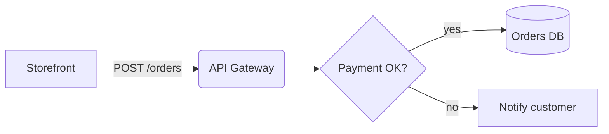

# Godhuli Shop

[](https://github.com/godhuli/shop/actions) [](https://www.npmjs.com/package/@godhuli/shop) 

> An **orders** platform for small merchants, built for the _golden hour_ of commerce.


## Features

- **Fast checkout** with `bKash`, cards, and *cash on delivery*
- Real-time order tracking via [WebSockets][ws]
  - Per-customer channels
  - ~~Long polling~~ (removed in v2.0)
1. Install dependencies
2. Configure `.env`
   1. Copy `.env.example`
   2. Set `DATABASE_URL`

### Roadmap

- [x] Multi-currency totals
- [x] Gift messages
- [ ] Partial refunds
- [ ] Offline POS mode[^pos]

## Quick start

```bash
git clone https://github.com/godhuli/shop.git && cd shop
pnpm install && pnpm dev --port "${PORT:-3000}"
```

```ts
import { createOrder, type Order } from "@godhuli/shop";

const order: Order = await createOrder({ customerId: "usr_9KQ2", items: [{ sku: "TEA-01", qty: 2 }] });
console.log(`Created #${order.id} for ${order.total.toFixed(2)} BDT`);
```

```python
from godhuli import Client

client = Client(api_key=os.environ["GODHULI_API_KEY"])
paid = [o for o in client.orders.list(status="paid") if o.total > 1_000]
```

```php
<?php
$order = Godhuli\Order::find(10016);
echo "Status: {$order->status}\n";
```

#### Configuration

| Key              | Type      | Default |                  Description |
| :--------------- | :-------: | ------: | ---------------------------: |
| `currency`       | `string`  | `"BDT"` |  ISO 4217 code for totals    |
| `maxItems`       | `number`  |   `50`  |  Line items allowed per order|
| `giftWrap`       | `boolean` | `false` |  Offer gift wrapping         |

```json
{ "currency": "BDT", "maxItems": 50, "giftWrap": true, "webhooks": ["https://example.com/hook"] }
```

```yaml
shop:
  name: Godhuli Shop
  checkout: { express: true, timeoutSeconds: 900 }
```

## Architecture



> [!NOTE]
> Webhook payloads are signed with `HMAC-SHA256`; verify the `X-Godhuli-Signature` header.

> [!WARNING]
> The `legacyCheckout` flag will be **removed** in v3.0.0.

<details>
<summary>Migrating from v1</summary>

```diff
- import { Shop } from "godhuli-shop";
+ import { createShop } from "@godhuli/shop";
```

</details>

---

Released under the [MIT License](LICENSE). See the [changelog][changelog] for history.

[ws]: https://developer.mozilla.org/en-US/docs/Web/API/WebSockets_API
[changelog]: ./CHANGELOG.md
[^pos]: Requires the companion Android app, currently in private beta.
